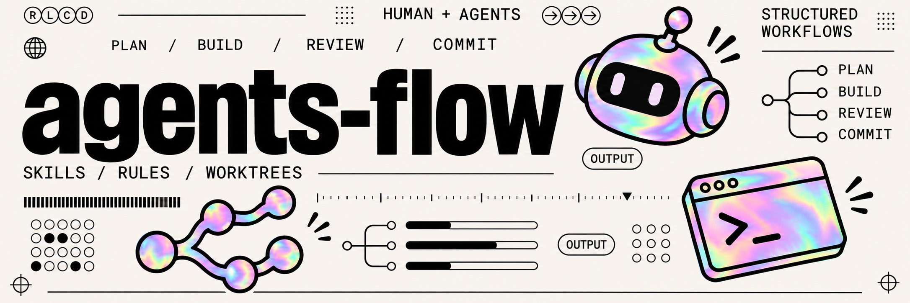

# agents-flow

[](https://github.com/EgorYolkin/agents-flow/stargazers)
[](https://github.com/EgorYolkin/agents-flow/forks)
[](https://github.com/EgorYolkin/agents-flow/commits/main/)
[](docs/INSTALLING_GUIDE.md)

Скиллы для AI-агентов, которые пишут, исправляют и проверяют код, а также
готовят инструкции для работы с репозиторием. Они задают
единые правила стиля и помогают сохранять поведение программы при изменениях.
Языковые скиллы основаны на Google Style Guides с оговорками для реальных
проектов. Docker-скилл содержит отдельные рекомендации по сборке образов.

Установите скиллы, которые нужны для ваших задач.

## Установка через агента

В уже клонированном репозитории agents-flow передайте своему coding-агенту
этот промпт:

```text
Прочитай локальный docs/INSTALLING_GUIDE.md в клоне agents-flow
и установи скиллы по его инструкциям. Согласуй со мной набор, область
установки и изменения лимита контекста. Если путь к клону неизвестен, спроси меня.
```

Агент предложит подходящие скиллы, уточнит место установки и проверит результат.
Руководство читается из локальной копии, даже если репозиторий станет приватным.

## Доступные скиллы

| Скилл | Для чего |
|---|---|
| [Git](skills/git-guide/SKILL.md) | Ветки задач, worktrees, изучение истории и осмысленные коммиты без захвата чужих изменений |
| [Project Init](skills/project-init/SKILL.md) | Уточняет цель, подбирает скиллы для задачи и при необходимости подключает `init` |
| [Init](skills/init/SKILL.md) | Готовит два файла инструкций: `AGENTS.md` и `GIT_WORKFLOW.md`. Состояние Git не меняет |
| [Dockerfile](skills/dockerfile-styleguide/SKILL.md) | Dockerfile и `.dockerignore`: сборка, кэширование, размер образа и безопасность |
| [Go](skills/go-styleguide/SKILL.md) | Имена и `gofmt`, контракты экспортируемого API, ошибки и выбор между конкретным типом, интерфейсом и параметром типа |
| [Python](skills/python-styleguide/SKILL.md) | Именование, импорты, типы, docstrings, комментарии и зависимости через `uv` и `requirements.txt` |
| [HTML/CSS](skills/html-css-styleguide/SKILL.md) | Разметка, стили и шаблоны с сохранением доступности и используемых селекторов |
| [Shell](skills/shell-styleguide/SKILL.md) | Bash и sh: quoting, аргументы, обработка ошибок и совместимость |
| [TypeScript](skills/typescript-styleguide/SKILL.md) | TypeScript и TSX: типы и имена публичного API, проверка входных данных и контракты компонентов |
| [Swift](skills/swift-styleguide/SKILL.md) | Swift: оформление, API, обработка optional и документация |
| [Vim script](skills/vimscript-styleguide/SKILL.md) | Vimscript: контракты autoload-функций, состояние буфера, клавиатурные привязки и совместимость |
| [Markdown](skills/markdown-styleguide/SKILL.md) | README, документация и инструкции: структура, ссылки и примеры |

## Как пользоваться

Если цель не указана, `project-init` уточняет её, а не выбирает задачу
из примеров в README. Для обзора или плана агент только изучает проект.
По запросу «сначала примени `init`» он готовит инструкции, не приступая
к разработке. Перед согласованной реализацией он подключает `init`, если
в корне проекта нет `AGENTS.md` или `GIT_WORKFLOW.md`. Отсутствие Git само
по себе не повод запускать `init` или создавать репозиторий.

Агент выбирает руководства по стилю для конкретной задачи. Перед каждым
значимым изменением кода, не только в начале проекта, он загружает `git-guide`.
При необходимости назовите скилл явно:

```text
Используй git-guide при работе над задачей. Изучи релевантную историю,
выбери ветку и изоляцию, сохраняй законченные шаги осмысленными коммитами.
Не включай чужие изменения. Push и merge пока не выполняй.
```

```text
Используй init. Подготовь проект к работе агента: изучи архитектуру,
команды, проверки и Git-соглашения. Создай или аккуратно обнови AGENTS.md
с заголовком Repository Guidelines и проектный GIT_WORKFLOW.md.
Сохрани существующие правила и пользовательские изменения.
```

`init` изучает существующие соглашения Git, но не создаёт репозиторий,
не меняет ветку, не добавляет файлы в индекс и не делает коммиты.
В пакете есть только [пример оформления workflow](skills/init/GIT_WORKFLOW_EXAMPLE.md);
рабочий `GIT_WORKFLOW.md` создаётся в целевом проекте и доступен для изменения.
Если попросить «подготовь инструкции с моими Git-правилами», `init` прочитает
актуальный `git-guide` как источник для документа, а не как поручение
выполнить Git-операции. Если источник недоступен, агент сообщит об этом.

```text
Используй shell-styleguide. Проверь scripts/deploy.sh и объясни замечания.
Пока ничего не меняй.
```

```text
Используй python-styleguide. Исправь стиль в изменённых Python-файлах,
сохрани публичные API и совместимость с поддерживаемыми версиями Python.
Проверь ответственность функций и запусти доступные проверки проекта.
```

```text
Используй typescript-styleguide. Исправь стиль в изменённых файлах,
сохрани публичные API и поведение. Запусти доступные проверки проекта.
```

```text
Используй dockerfile-styleguide. Проверь Dockerfile и .dockerignore,
затем исправь найденные проблемы в рамках текущего приложения.
```

```text
Используй go-styleguide. Проверь Go-пакет checkpoint: можно ли по сигнатурам
и комментариям понять, когда чтение вернёт io.EOF, а когда запись оборвана?
Отдели ошибки контракта от замечаний по стилю. Код пока не меняй.
```

Автоматическое подключение зависит от вашего агента. Если он не выбрал скилл,
попросите применить его явно. Для смешанной задачи можно использовать несколько
скиллов: например, Docker и Shell для образа с entrypoint-скриптом.

Python-скилл требует использовать `uv` для зависимостей и всегда вести
`requirements.txt`, даже если сторонних библиотек нет. В docstrings модулей,
классов, функций и методов `"""` стоят на отдельных строках. Краткие описания
в docstrings и комментарии пишутся на английском, со строчной буквы и без
точки в конце. После docstring и между смысловыми блоками оставляется пустая
строка. Связанные операции и дополняющие их `if` остаются рядом.
После проверки с досрочным выходом и между изменением состояния и `return`
оставляется пустая строка.

## Что ожидать

Скиллы учитывают договорённости проекта и ограничения совместимости. Запрос
«проверь» предполагает замечания; запрос «исправь» — изменения в указанной
области. Они не должны запускать массовое переформатирование ради небольшого
исправления.

Скилл даёт агенту процедуру работы. Проверка поведения по-прежнему требует
тестов, а обязательные ограничения — подходящих проверок проекта и CI.

Источники, версии руководств и атрибуция приведены в `references/` соответствующих
скиллов. Порядок установки, обновления и применения описан в
[руководстве для агента](docs/INSTALLING_GUIDE.md).
